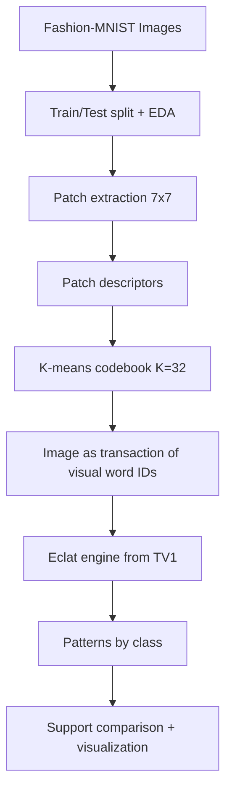

# Kế hoạch đồ án Frequent Itemset Mining — Eclat bằng Julia

> **Môn học:** Data Mining — HCMUS  
> **Nhóm:** TV1 — Trung; TV2 — Khang; TV3 — Duy  
> **Ngôn ngữ:** Julia >= 1.9  
> **Thuật toán:** Eclat (Vertical TID-set, DFS)  
> **Ứng dụng 1:** Groceries — Market Basket Analysis  
> **Ứng dụng 2:** Fashion-MNIST — Visual Pattern Mining  
> **Đối chiếu:** SPMF Eclat  
> **Benchmark datasets:** Chess, Mushroom, Retail, T10I4D100K

**Tài liệu đề bài:** https://hcmus-cs-ta.github.io/lab-book/data-mining/projects/itemset/

---

## 1. Mục tiêu & phạm vi

1. Tự cài đặt **Eclat** bằng Julia; không sao chép mã thuật toán FIM từ thư viện/nguồn có sẵn.
2. Có **baseline** dùng `Set{Int}` và bản **optimized** dùng `BitVector` / `BitArray` (đánh giá cả thời gian lẫn bộ nhớ, không mặc định phiên bản bitset luôn tốt hơn).
3. Kiểm chứng chính xác bằng **SPMF**: so sánh _toàn bộ tập itemset và support count_, không chỉ số lượng itemset.
4. Benchmark trên **4 bộ dữ liệu** với nhiều ngưỡng minimum support; phân tích runtime, peak memory, khả năng mở rộng và ảnh hưởng của mật độ giao dịch.
5. Xây dựng **2 ứng dụng thực tế**, cùng sử dụng core Eclat của nhóm:
   - **Groceries:** tìm frequent itemsets và association rules (support, confidence, lift).
   - **Fashion-MNIST:** biến ảnh thành các tập visual words, tìm frequent visual patterns theo từng lớp quần áo.
6. Hoàn thiện repository công khai, unit tests, demo Google Colab chạy được và báo cáo theo yêu cầu của đề (dự kiến chuẩn IEEE, 10–15 trang; đối chiếu rubric mới nhất trước khi nộp).

---

## 2. Phân công trách nhiệm

| Thành viên | Vai trò                            | Công việc chính                                                                                               | Deliverables                                                                                    | Độ khó ước lượng |
| ---------- | ---------------------------------- | ------------------------------------------------------------------------------------------------------------- | ----------------------------------------------------------------------------------------------- | ---------------- |
| **TV1 — Trung** | **Algorithm & Optimization Lead**  | Đọc paper; Eclat baseline; Eclat optimized; API; CLI; unit tests; xác minh SPMF                               | `EclatBaseline.jl`, `EclatOptimized.jl`, `EclatFIM.jl`, `test/runtests.jl`, tài liệu thuật toán | Cao              |
| **TV2 — Khang** | **Benchmark & Market Basket Lead** | Chuẩn bị benchmark; runner/đo hiệu năng; tiền xử lý Groceries; association rules; bảng/biểu đồ                | `Benchmark.jl`, `Groceries.jl`, `AssociationRules.jl`, kết quả benchmarks, top-10 rules         | Trung bình–cao   |
| **TV3 — Duy**   | **Visual Mining & Demo Lead**      | Đọc Fashion-MNIST; patch descriptors; K-means/codebook; transactions; phân tích visual pattern; tích hợp demo | `FashionMNIST.jl`, `VisualCodebook.jl`, `VisualMining.jl`, plots, `demo.ipynb`                  | Cao              |

### Quy định phối hợp

- **TV1** sở hữu API Eclat và trách nhiệm correctness. Mọi thay đổi API phải được cả nhóm đồng thuận.
- **TV2/TV3** không viết lại Eclat; chỉ làm preprocess, gọi API và xử lý đầu ra.
- **TV2** chịu trách nhiệm thiết kế benchmark; **TV1** hỗ trợ correctness/optimization; **TV3** hỗ trợ tái lập trong Colab.
- Mỗi thành viên viết phần báo cáo của module mình và review ít nhất một module khác.
- Mỗi module làm việc trên branch riêng, thông qua pull request trước khi merge vào `main`.

---

## 3. Hợp đồng tích hợp (API & định dạng dữ liệu)

### 3.1. Input chung

```julia
transactions::Vector{Vector{Int}}
# Mỗi transaction là danh sách item ID dương.
# Ví dụ: [[1, 2, 3], [1, 3], [2, 3, 4]]
```

Các item phải **duy nhất trong một transaction** nhưng **không được xóa transaction trùng nhau** (hai giỏ hàng giống nhau vẫn là hai giao dịch khác nhau).

### 3.2. API chung (đề xuất)

```julia
mine(transactions, minsup::Real; backend=:set)
mine(transactions, minsup::Real; backend=:bitvector)
```

- Nếu `0 < minsup <= 1`: minsup là tỷ lệ; chuyển thành `ceil(Int, minsup * n_transactions)`.
- Nếu muốn hỗ trợ minsup tuyệt đối, thiết kế tham số riêng `min_count::Int` để tránh nhầm giữa tỷ lệ và số đếm.
- Output chuẩn: `Dict{Tuple{Vararg{Int}}, Int}` với key là itemset **đã sắp xếp tăng dần**, value là **support count**.
- Cùng một input, hai backend phải cho ra cùng output.

### 3.3. SPMF compatibility

- Input mỗi dòng gồm các item ID phân cách bởi dấu cách, một dòng là một transaction.
- Lưu file mapping để chuyển ngược từ integer ID sang nhãn sản phẩm/visual words.
- Khi so sánh SPMF: chuẩn hóa output về `sorted item tuple -> support_count`.
- Kiểm tra: `missing_itemsets == 0`, `extra_itemsets == 0`, `support_mismatches == 0`.

---

## 4. Timeline 4 tuần

| Tuần  | TV1 (Trung) — Eclat                                 | TV2 (Khang) — Benchmark & Groceries                                   | TV3 (Duy) — Fashion-MNIST                                      | Mốc kiểm tra                                                     |
| ----- | --------------------------------------------------- | --------------------------------------------------------------------- | -------------------------------------------------------------- | ---------------------------------------------------------------- |
| **1** | Đọc paper, pseudocode, baseline với `Set{Int}`, API | Tải 4 benchmark datasets, parser SPMF/Groceries, xây transactions     | Tải Fashion-MNIST, EDA, đọc ảnh, patch extraction MVP          | Core baseline chạy toy data; cả 2 ứng dụng tạo được transactions |
| **2** | BitVector backend, unit tests, SPMF correctness     | Association rules, benchmark runner, script xuất CSV/plots            | K-means, codebook, visual transactions, kiểm thử 100–1.000 ảnh | Hai ứng dụng gọi được core; correctness pass trên test nhỏ       |
| **3** | Tối ưu, so sánh 2 backend, hỗ trợ benchmark         | Chạy 4 benchmarks; runtime/memory/scalability; Groceries top-10 rules | Mine từng class; class-specific patterns; trực quan hóa        | Có số liệu thật cho 2 app + benchmark                            |
| **4** | Complexity, thuật toán, code review                 | Biểu đồ và báo cáo benchmark/Groceries                                | Colab demo, báo cáo visual mining, tái lập toàn bộ             | Báo cáo, README, tests, demo, GitHub public hoàn chỉnh           |

### Các mốc cứng

- **Ngày 2:** chốt `Project.toml`, conventions, API, output schema, cấu trúc repository.
- **Cuối tuần 1:** cả ba module tạo/đọc được transactions; TV1 có baseline Eclat tối thiểu.
- **Cuối tuần 2:** Groceries và Fashion-MNIST gọi được Eclat chung; correctness khớp SPMF trên bộ test nhỏ.
- **Cuối tuần 3:** freeze kết quả thực nghiệm để viết báo cáo; ghi lại random seed, version và cấu hình máy.
- **Cuối tuần 4:** mọi test pass; chạy lại từ môi trường sạch; tập dượt vấn đáp.

---

## 5. Chi tiết module TV1 (Trung) — Eclat Core

### Nhiệm vụ

1. Đọc original paper về Eclat, trình bày vertical data representation và equivalence classes.
2. Implement **baseline**: ánh xạ `item -> Set{Int}` của transaction IDs; DFS mở rộng các prefix; tính support bằng giao TID-set.
3. Implement **optimized**: `item -> BitVector`, tính giao bằng phép `.&` và `count` các bit bật; cân nhắc chiến lược cấp phát/tái sử dụng bộ nhớ và pruning.
4. Định nghĩa API chuẩn, CLI và cách xuất itemsets.
5. Unit tests cho: item đơn, itemset nhiều item, tập rỗng, item không đủ support, transaction trùng, input không được sắp xếp, các ngưỡng support biên.
6. So sánh exact match với SPMF trên ít nhất 5 cơ sở dữ liệu/tập thử (bao gồm toy/test nhỏ và dữ liệu benchmark theo rubric).
7. Phân tích trade-off `Set{Int}` vs `BitVector` trên dữ liệu dense/sparse.

### Definition of Done

- [ ] Baseline và optimized trả về output **giống nhau**.
- [ ] Exact match itemsets + support count với SPMF trên tất cả cấu hình kiểm chứng.
- [ ] Có lệnh CLI nhận đường dẫn dữ liệu, minsup, backend và output path.
- [ ] Có tests và giải thích độ phức tạp / chiến lược pruning.

---

## 6. Chi tiết module TV2 (Khang) — Groceries & Benchmark

### 6.1. Groceries — preprocessing

**Dataset:** https://raw.githubusercontent.com/stedy/Machine-Learning-with-R-datasets/master/groceries.csv

- Mỗi dòng là một **basket transaction**; dữ liệu CSV dạng danh sách item có số cột thay đổi, không đọc như một bảng rectangular cố định.
- `strip` khoảng trắng; bỏ item trùng trong cùng giỏ; không bỏ giỏ hàng trùng nhau.
- Tạo vocabulary xác định, `item_name -> Int`, xuất `groceries_spmf.txt` và `item_mapping.csv`.
- Kiểm tra thống kê kỳ vọng (phiên bản dataset quen thuộc): khoảng **9.835 transactions**, **169 distinct items**; nếu khác, kiểm tra version/parser thay vì sửa dữ liệu cưỡng ép.

### 6.2. Groceries — mining & association rules

- Chạy Eclat trên nhiều minsup, ví dụ pilot: **0,5% / 1% / 2% / 3%**; chọn mức chính dựa trên số rules và thời gian thực tế.
- Sinh association rules từ frequent itemsets bằng code của nhóm.
- Tính:
  - `support(X -> Y) = count(X ∪ Y) / N`
  - `confidence(X -> Y) = count(X ∪ Y) / count(X)`
  - `lift(X -> Y) = confidence(X -> Y) / (count(Y) / N)`

- Lọc theo minimum confidence (thử 0,3 / 0,5 / 0,7), xếp **top 10 theo lift**; kèm support count để tránh phóng đại luật hiếm.
- Phân tích ý nghĩa bán lẻ, hạn chế: co-occurrence không chứng minh nhân quả.

### 6.3. Benchmark chính

| Dataset    | Đặc trưng               | Phân tích kỳ vọng                              |
| ---------- | ----------------------- | ---------------------------------------------- |
| Chess      | Dense                   | Branching factor / nhiều frequent itemsets dài |
| Mushroom   | Dense                   | Giao TID-set và memory                         |
| Retail     | Sparse, nhiều loại item | Tác động sparse data và peak RAM               |
| T10I4D100K | Synthetic, sparse       | Scalability và runtime                         |

- Với mỗi dataset: pilot minsup cao, chọn **5–7 mức** trong vùng có thể đo; ghi cả timeout/OOM khi có.
- So sánh **Julia baseline**, **Julia optimized**, **SPMF Eclat** cùng dữ liệu và minsup.
- Thu thập: wall-clock runtime, peak RSS, số lượng frequent itemsets, tình trạng thành công/thất bại.
- Đo scalability trên các tập con cố định của Retail: **10% / 25% / 50% / 75% / 100%**.
- Warm-up trước benchmark để tách ảnh hưởng JIT; lặp lại nhiều lần (ví dụ 5), báo cáo median. Phân biệt allocation do `BenchmarkTools.jl` đo với **peak RSS** của tiến trình; không dùng chúng thay thế nhau.
- SPMF chạy bằng Java trên cùng máy; báo cáo rõ cách xử lý chi phí khởi động JVM, compilation, disk I/O và thời gian load data để so sánh công bằng.

### Definition of Done

- [x] Dataset preprocess xong, mapping kiểm chứng được.
- [x] Có top 10 rules theo lift và ví dụ giải thích thực tế.
- [x] Đủ 4 benchmarks, mỗi dataset có nhiều minsup và dữ liệu gốc để tái lập.
- [x] Có biểu đồ runtime, memory, itemset count, scalability và thảo luận về dense/sparse.

Chứng cứ bàn giao: [checklist TV2](TV2_checklist.md),
[báo cáo Groceries](report_groceries.md), [báo cáo benchmark](report_benchmark.md).
Colab, bản lưu trữ dữ liệu và PDF chung vẫn cần hoàn tất trước khi nộp.

---

## 7. Chi tiết module TV3 (Duy) — Fashion-MNIST Visual Pattern Mining

**Nguồn:** https://github.com/zalandoresearch/fashion-mnist

### 7.1. Thiết kế MVP

- Dữ liệu: **70.000 ảnh grayscale 28×28**, 10 lớp. Ban đầu lấy **5.000 ảnh train**, phân tầng cân bằng theo class; mở rộng sau khi code ổn định.
- Chia ảnh thành **16 patches kích thước 7×7** (lưới 4×4).
- Descriptor ban đầu: pixel intensity vector đã chuẩn hóa, hoặc đặc trưng thống kê đơn giản (`mean`, `std`, gradient) dễ cài bằng Julia. Tách các patch gần như toàn nền đen nếu cần.
- Huấn luyện **K-means** trên các patch từ tập train để tạo **32 visual words** (tăng/giảm K trong ablation).
- Ánh xạ mỗi patch tới visual-word ID gần nhất; mỗi ảnh là **tập các visual-word IDs duy nhất** — transaction.
- Mã hóa ID ổn định; class label **không nằm trong transaction**, mà lưu metadata tách biệt.
- Chạy Eclat trên từng class và/hoặc trên toàn bộ ảnh; xem support tương đối theo class.

### 7.2. Pipeline



### 7.3. Đánh giá và giải thích

- Tính **class-conditional support** của pattern: `support_class(P) = #ảnh class chứa P / #ảnh class`.
- So sánh với nhóm còn lại để phát hiện **pattern phổ biến hơn trong class mục tiêu**, nhưng **không khẳng định pattern là bộ phân loại hoặc nguyên nhân của nhãn**.
- Trực quan hóa ảnh đại diện chứa pattern; trực quan hóa patch/visual words điển hình nếu ánh xạ được.
- Ablation tối thiểu: số visual words (`K=16, 32, 64`) hoặc descriptor khác nhau; phân tích ảnh hưởng đến pattern count và diễn giải.
- Chỉ dùng test split để đánh giá tính ổn định, không fit codebook trên test nếu muốn đánh giá ngoài mẫu.
- Ghi rõ nguy cơ codebook tạo nhiều visual words đại diện cho nền đen hoặc texture nghèo thông tin.

### Lưu ý thư viện

Ưu tiên viết các bước cốt lõi bằng Julia (`Arrays`, `LinearAlgebra`, `Statistics`). **Xác nhận với TA** phạm vi được phép sử dụng các package hỗ trợ load ảnh/clustering/plotting; không dùng thư viện frequent itemset mining thay cho Eclat tự cài.

### Definition of Done

- [ ] Có script tải/đọc dataset, EDA và fixed seed.
- [ ] Có visual codebook và ít nhất một pipeline image → transaction có kiểm thử.
- [ ] Mining bằng Eclat của nhóm; có top patterns / so sánh theo class.
- [ ] Có visualization và một thí nghiệm ablation.
- [ ] Notebook Colab hoặc demo tương đương chạy lại được theo yêu cầu đề.

---

## 8. Cấu trúc repository

```text
eclat-fim/
├── Project.toml
├── Manifest.toml
├── README.md
├── src/
│   ├── EclatFIM.jl
│   ├── algorithm/
│   │   ├── EclatBaseline.jl
│   │   └── EclatOptimized.jl
│   ├── applications/
│   │   ├── Groceries.jl
│   │   ├── AssociationRules.jl
│   │   ├── FashionMNIST.jl
│   │   ├── VisualCodebook.jl
│   │   └── VisualMining.jl
│   └── utils/
│       └── SPMFIO.jl
├── scripts/
│   ├── benchmark.jl
│   ├── groceries_demo.jl
│   ├── fashion_demo.jl
│   └── demo.jl
├── test/
│   └── runtests.jl
├── data/
│   ├── raw/
│   ├── processed/
│   └── benchmark/
├── results/
│   ├── benchmarks/
│   ├── groceries/
│   └── fashion/
├── notebooks/
│   └── demo.ipynb
└── docs/
    └── Report.pdf
```

**Ghi chú:** Dataset lớn không nhất thiết commit vào GitHub. Cung cấp script tải dữ liệu, checksum/version và hướng dẫn chạy; nên Git-ignore raw datasets/results không cần thiết.

---

## 9. Phân công viết báo cáo & review chéo

| Phần báo cáo                                         | Người phụ trách  | Người review |
| ---------------------------------------------------- | ---------------- | ------------ |
| Giới thiệu & kết luận                                | Cả nhóm          | Cả nhóm      |
| Chương 1: thuật toán Eclat, complexity, optimization | TV1 (Trung)      | TV2 (Khang)  |
| Chương 2: benchmark, correctness, runtime, memory    | TV2 (Khang), TV1 (Trung) hỗ trợ | TV1 (Trung) |
| Chương 3.1: Groceries                                | TV2 (Khang)      | TV3 (Duy)    |
| Chương 3.2: Fashion-MNIST                            | TV3 (Duy)        | TV1 (Trung)  |
| Hướng dẫn tái lập, Colab, README                     | TV3 (Duy)        | TV1 (Trung) + TV2 (Khang) |
| Final QA, chuẩn format IEEE                          | Cả nhóm          | Cả nhóm      |

**Checklist hình/biểu đồ:**

- [ ] Pseudocode / workflow Eclat.
- [ ] Sơ đồ architecture và API tích hợp.
- [ ] Runtime vs minsup cho 4 benchmark datasets.
- [ ] Peak memory vs minsup hoặc backend.
- [ ] Scalability vs số transaction.
- [ ] Top 10 Groceries association rules theo lift.
- [ ] Fashion-MNIST: một số ảnh đại diện, pattern support theo class, ablation.
- [ ] Nêu cấu hình máy, Julia version, package version, seed, data sources và cách tái lập.

---

## 10. Rủi ro và phương án dự phòng

| Rủi ro                                        | Dấu hiệu                         | Cách xử lý                                                                |
| --------------------------------------------- | -------------------------------- | ------------------------------------------------------------------------- |
| Eclat sinh quá nhiều itemsets khi minsup thấp | Runtime/RAM tăng đột biến        | Pilot minsup từ cao xuống thấp; đặt timeout; báo cáo failure có kiểm soát |
| `BitVector` kém hơn `Set` trên sparse data    | RAM/runtime optimized không giảm | Giữ cả hai backend; phân tích điều kiện dense/sparse thay vì ép kết quả   |
| Julia JIT làm benchmark sai lệch              | Lần đầu chạy lâu bất thường      | Warm-up, lặp nhiều lần, phân biệt compile vs execution                    |
| Codebook Fashion-MNIST chỉ học background     | Top visual words thiếu ý nghĩa   | Lọc patch nền, xem cluster centroid/patch mẫu; thử descriptor khác        |
| Fashion-MNIST toàn bộ 70k quá nặng            | K-means/mining lâu               | MVP 5k ảnh cân bằng; tối ưu và mở rộng sau                                |
| API thay đổi khi 2 app đang phát triển        | Merge conflict, lỗi integration  | Freeze API ngày 2; PR review; contract tests                              |
| Không tái lập được Colab Julia                | Lỗi phiên bản/cài Julia          | Pin Julia + Manifest, script setup rõ ràng; chạy thử Colab sớm từ tuần 2  |
| Thiếu thời gian làm báo cáo                   | Có code nhưng thiếu đánh giá     | Freeze kết quả tuần 3; mỗi người viết báo cáo song song từ sớm            |

---

## 11. Checklist Sprint 1 — bắt đầu ngay

### TV1 — Trung

- [ ] Đọc paper Eclat và viết pseudocode ~1 trang.
- [ ] Tạo Julia project, thống nhất API/output.
- [ ] Implement baseline chạy đúng trên 5 toy transactions.
- [ ] Viết test cho support count và no-duplicate itemsets.

### TV2 — Khang

- [ ] Download / xác minh Chess, Mushroom, Retail, T10I4D100K.
- [ ] Tạo parser SPMF và script chuẩn hóa benchmark.
- [ ] Tải Groceries, kiểm tra transaction count và item vocabulary.
- [ ] Tạo `groceries_spmf.txt` cùng item mapping.

### TV3 — Duy

- [ ] Tải Fashion-MNIST, hiển thị ảnh mẫu theo 10 lớp.
- [ ] Viết patch extraction 7×7 trên 100 ảnh.
- [ ] Xây transaction prototype; xác minh loại bỏ duplicate visual words.
- [ ] Chốt hướng descriptor và K-means; xin TA xác nhận package nếu cần.

### Cả nhóm

- [ ] Chốt conventions code style, branch naming, output format và seeds.
- [ ] Thiết lập GitHub Issues/Project Board, PR review.
- [ ] Cài Julia, pin `Project.toml` và `Manifest.toml`.
- [ ] Kiểm tra với TA nếu còn điểm chưa rõ trong rubric (thư viện Julia, Colab setup, giới hạn dữ liệu).

---

## 12. Tiêu chí chốt đồ án (Definition of Done toàn nhóm)

- [ ] **Correctness:** Eclat Julia baseline/optimized và SPMF khớp từng itemset + support trên các trường hợp kiểm thử yêu cầu.
- [ ] **Benchmark:** đủ 4 datasets, dải minsup, runtime, peak RAM, scalability, phân tích dense/sparse và tối ưu có đo lường.
- [ ] **Groceries:** pipeline dữ liệu → Eclat → frequent itemsets → association rules → top 10 lift và diễn giải.
- [ ] **Fashion-MNIST:** pipeline ảnh → codebook → transactions → Eclat → so sánh pattern theo class và visualization.
- [ ] **Reproducibility:** GitHub public, README rõ, tests pass, Julia dependencies cố định, demo Colab chạy từ đầu đến cuối.
- [ ] **Report:** đúng định dạng và phạm vi đề; biểu đồ và kết luận truy vết được về file kết quả thực nghiệm.

---

## 13. Nguồn tài liệu và dataset

1. **Đề bài HCMUS:** https://hcmus-cs-ta.github.io/lab-book/data-mining/projects/itemset/
2. **SPMF datasets:** https://www.philippe-fournier-viger.com/spmf/datasets.php
3. **FIMI benchmark datasets:** https://cs.rpi.edu/~zaki/Workshops/FIMI/data/
4. **Groceries CSV:** https://raw.githubusercontent.com/stedy/Machine-Learning-with-R-datasets/master/groceries.csv
5. **Fashion-MNIST official repository:** https://github.com/zalandoresearch/fashion-mnist
6. **SPMF Eclat documentation:** https://www.philippe-fournier-viger.com/spmf/Eclat_dEclat.php
7. **Julia documentation:** https://docs.julialang.org/
8. **BenchmarkTools.jl:** https://github.com/JuliaCI/BenchmarkTools.jl
