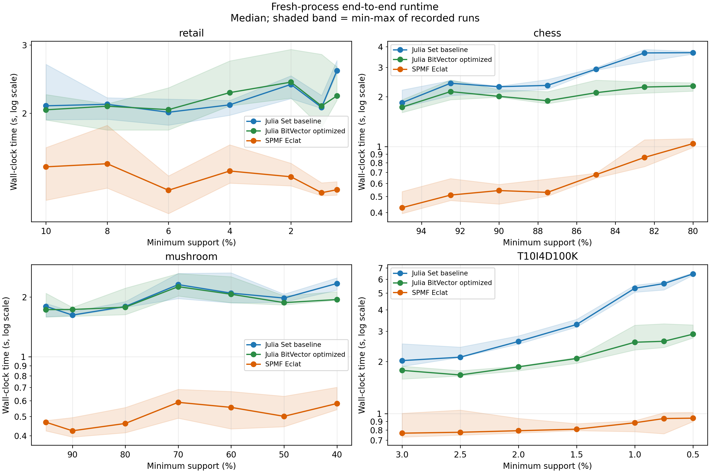
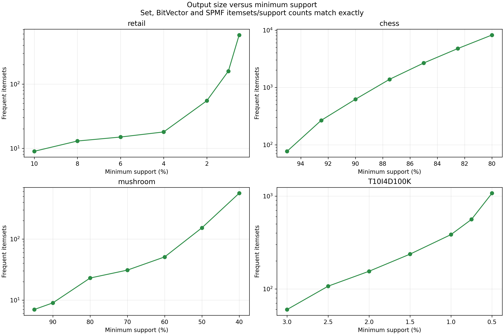
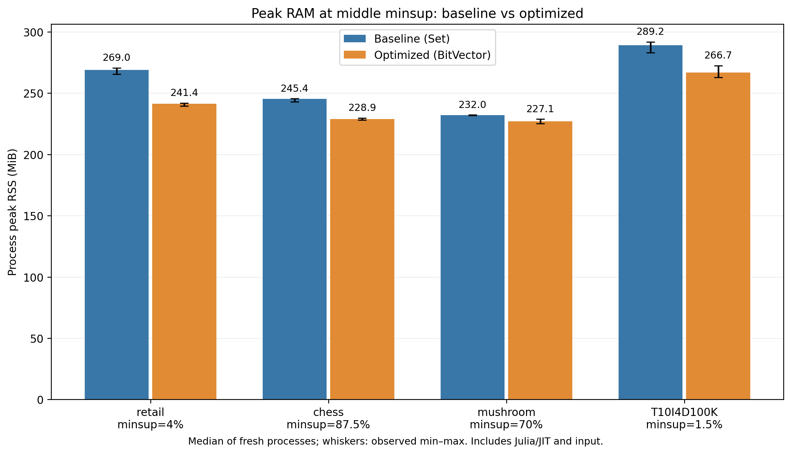
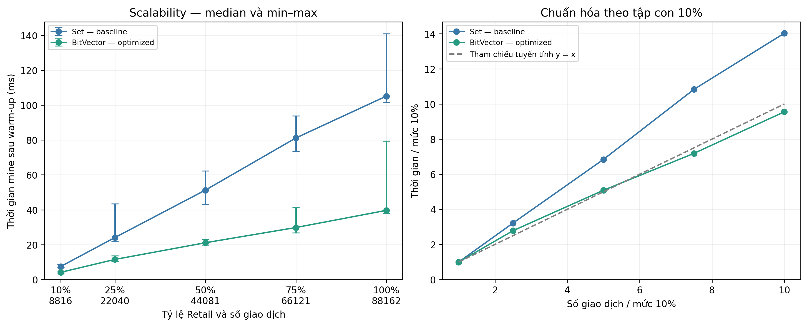
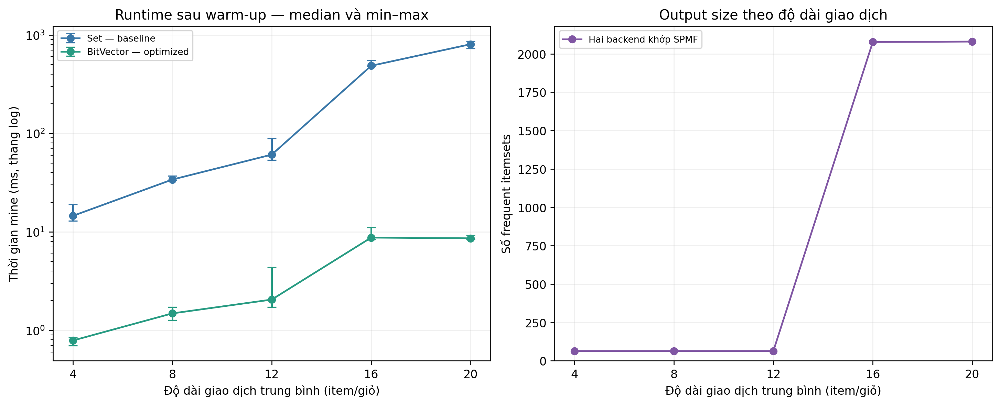

# Báo cáo tổng hợp thực nghiệm Eclat

Báo cáo tổng hợp bốn nhóm thực nghiệm của Eclat Julia: runtime và số frequent
itemsets theo minsup, Peak RAM, scalability theo số giao dịch, và ảnh hưởng của
độ dài giao dịch. Các bảng lấy từ CSV của những lần đo đã thực hiện; mỗi phần
liên kết đến dữ liệu gốc, metadata và biểu đồ tương ứng.

Các script Python trong `scripts/plot_*.py` chỉ đọc/kiểm tra CSV và vẽ hình.
Báo cáo này được biên tập trong `docs/`, không tự sinh khi chạy script vẽ.

## 1. Phạm vi, dữ liệu và nguyên tắc so sánh

| Thí nghiệm | Cấu hình | Mẫu đã đo | Đại lượng chính | Phiên bản được so sánh |
| --- | --- | ---: | --- | --- |
| [Runtime theo minsup](#runtime) | 4 dataset × 7 minsup × 3 chương trình × 5 lần | 420 | Wall-clock toàn bộ tiến trình, giây | Julia Set, BitVector và SPMF Eclat |
| [Peak RAM](#peak-ram) | 4 dataset × 2 backend × 5 lần | 40 | Đỉnh RSS tiến trình đến hết mining, MiB | Julia Set và BitVector đã lọc singleton |
| [Scalability](#scalability) | 5 tỷ lệ Retail × 2 backend × 5 lần | 50 | Wall-clock của `mine` sau warm-up, ms | Julia Set và BitVector đã lọc singleton |
| [Độ dài giao dịch](#transaction-length) | 5 độ dài tổng hợp × 2 backend × 5 lần | 50 | Wall-clock của `mine` sau warm-up và số itemsets | Julia Set và BitVector đã lọc singleton |

Tổng cộng **560 mẫu đã đo** đều khớp toàn bộ itemset và support count với tham
chiếu SPMF trong thí nghiệm tương ứng. Correctness được kiểm tra ngoài phần đo.
Không ghép trực tiếp runtime toàn bộ tiến trình với thời gian riêng của `mine`;
không dùng allocation hoặc kích thước object để thay cho Peak RSS.

Máy đo dùng Julia 1.13.3, Windows x86_64, CPU `tigerlake`, 8 CPU logic, khoảng
15,73 GiB RAM và một luồng Julia. Java 25.0.1 được dùng cho SPMF; phiên bản đầy
đủ và SHA-256 JAR, source, input được lưu trong metadata từng lần đo. Các lần
đo không diễn ra đồng thời và Windows vẫn có tiến trình nền.

### Dữ liệu thực

| Dataset | Số giao dịch | Item khác nhau | Độ dài trung bình | Chuẩn hóa ID |
| --- | ---: | ---: | ---: | --- |
| Chess | 3.196 | 75 | 37,0000 | Giữ nguyên |
| Mushroom | 8.124 | 119 | 23,0000 | Giữ nguyên |
| Retail | 88.162 | 16.470 | 10,3058 | Cộng 1 vào mọi ID |
| T10I4D100K | 100.000 | 870 | 10,1023 | Cộng 1 vào mọi ID |

Nguồn, thống kê và checksum dữ liệu gốc nằm trong [benchmark_data.md](benchmark_data.md).
Giữ các giao dịch trùng nhau; mỗi dòng vẫn có TID riêng. Bản Mushroom ở đây có
8.124 giao dịch; kiểm tra toàn bộ input khi đối chiếu correctness.

### Tổ chức chứng cứ

| Thư mục | CSV tổng hợp | Từng mẫu | Metadata |
| --- | --- | --- | --- |
| Runtime | [summary.csv](../results/benchmarks/processes/summary.csv) | [runs.csv](../results/benchmarks/processes/runs.csv) | [metadata.md](../results/benchmarks/processes/metadata.md) |
| Peak RAM | [summary.csv](../results/benchmarks/peak_ram/summary.csv) | [runs.csv](../results/benchmarks/peak_ram/runs.csv) | [metadata.md](../results/benchmarks/peak_ram/metadata.md) |
| Scalability | [summary.csv](../results/benchmarks/scalability/summary.csv) | [runs.csv](../results/benchmarks/scalability/runs.csv) | [metadata.md](../results/benchmarks/scalability/metadata.md) |
| Độ dài giao dịch | [summary.csv](../results/benchmarks/transaction_length/summary.csv) | [runs.csv](../results/benchmarks/transaction_length/runs.csv) | [metadata.md](../results/benchmarks/transaction_length/metadata.md) |

Metadata là bản ghi tại thời điểm đo. Checksum source có thể khác file hiện tại
nếu sau lần đo chỉ sửa mô tả, ngôn ngữ hoặc tổ chức báo cáo. Các CSV, tham chiếu
và biểu đồ gốc được giữ nguyên khi hợp nhất tài liệu. Riêng runtime theo minsup
đã đo lại cả ba chương trình trong cùng đợt để bổ sung BitVector; CSV và bảng
ở mục 2 là kết quả của đợt mới, không ghép mẫu từ đợt cũ.

### Kiểm thử tự động bằng Julia

Chạy `julia --project=. test/runtests.jl`. File
[test_benchmark.jl](../test/test_benchmark.jl) so sánh toàn bộ itemset và support
của Set/BitVector với đáp án SPMF trên toàn bộ 5 CSDL trong `data/`: Groceries
(9.835 giao dịch), Chess (3.196), Mushroom (8.124), Retail (88.162) và T10I4D100K
(100.000). Dùng input đã chuẩn hóa, không lấy mẫu. Minsup lần lượt là 1%, 87,5%,
70%, 4%, 1,5%; đáp án SPMF có 333, 1.386, 31, 18 và 237 itemsets.
Đáp án được lưu trong `results/groceries/` và `results/benchmarks/peak_ram/spmf/`.
Chạy test không cần Python hoặc gọi Java, nhưng phải chuẩn bị đủ dữ liệu lớn
đã chuẩn hóa trước; thiếu file sẽ báo lỗi, không tự bỏ qua.
Các test này kiểm tra correctness, tách biệt với 560 mẫu đo hiệu năng trên đây.
Đề không quy định unit test riêng từng hàm đo benchmark; các test hỗ trợ runner
và test Python đã được bỏ.

<a id="runtime"></a>

## 2. Runtime Julia baseline, optimized và SPMF

Đã đo lại **28 cấu hình, 420 mẫu**: 4 dataset × 7 minsup × 3 chương trình × 5 lần.
Cả Set và BitVector khớp 100% toàn bộ itemset/support với SPMF trong mọi mẫu.
Đây là một đợt đo mới cho cả ba chương trình, không nối thêm số đo optimized
vào các số baseline/SPMF của đợt trước.

### Cách đo

Mỗi mẫu tạo tiến trình mới, tính khởi động Julia/Java, nạp package/lớp, JIT,
đọc đầu vào, dựng TID-set, khai thác và ghi kết quả/log. Ba chương trình dùng
cùng input chuẩn hóa và minsup. Mỗi cấu hình có một lượt chuẩn bị mỗi chương
trình không ghi nhận; các lượt sau vẫn tạo tiến trình mới và tính JIT. Xoay vòng
thứ tự ba chương trình giữa các lần. Chuẩn hóa, mở log và đối chiếu toàn bộ
Dict thực hiện ngoài đồng hồ; lấy median, giữ min/max và từng mẫu.

Các số này là thời gian toàn bộ tiến trình, khác các CSV `*_baseline.csv`
đo riêng `mine` sau warm-up trên dữ liệu trong RAM. Cache hệ điều hành có sẵn;
không phải cold disk cache. Các tiến trình nền Windows không được kiểm soát
hoàn toàn. Cấu hình máy, phiên bản và checksum input/JAR/source/Manifest nằm
trong [metadata.md](../results/benchmarks/processes/metadata.md). Nhãn ECLAT
trong log không thay thế phiên bản hoặc SHA-256 của toàn bộ JAR.

### Kết quả tại minsup thấp nhất của mỗi bộ

| Dataset | Minsup | Itemsets | Set median (s) | BitVector median (s) | SPMF median (s) | Set/BitVector |
| --- | ---: | ---: | ---: | ---: | ---: | ---: |
| retail | 0.005 | 580 | 2.5762 | 2.2182 | 1.2675 | 1.16 |
| chess | 0.8 | 8227 | 3.6887 | 2.3216 | 1.0436 | 1.59 |
| mushroom | 0.4 | 565 | 2.3397 | 1.9420 | 0.5811 | 1.20 |
| T10I4D100K | 0.005 | 1073 | 6.4633 | 2.8884 | 0.9402 | 2.24 |

Tỉ số Set/BitVector lớn hơn 1 nghĩa là BitVector có median thấp hơn trong
cấu hình tương ứng. BitVector có median thấp hơn Set ở **23/28 cấu hình**;
SPMF thấp hơn cả hai backend Julia ở **28/28 cấu hình**. Không suy ra một
backend hoặc ngôn ngữ luôn nhanh hơn từ các điểm này.

### Phân tích và giới hạn

- Khi minsup giảm, số itemset tăng hoặc giữ nguyên. Eclat duyệt DFS và giao
  TID-set theo [mô tả thuật toán](TV1_algorithm.md); nhiều tổ hợp đạt support
  hơn có thể tạo thêm nhánh, giao tập, cấp phát và output. Runtime còn chịu
  JIT, GC, I/O và dao động hệ thống, nên không bắt buộc tăng tại mọi điểm.
- Set lưu các TID có mặt; chi phí dựng bảng băm và giao tập phụ thuộc kích
  thước các TID-set. BitVector có chiều dài theo N và lọc singleton trước khi
  cấp vector, nhưng vẫn phải đếm support, quét lại input, giao/đếm ứng viên.
  Dense/sparse, số item sống sót và output cùng ảnh hưởng kết quả; không chỉ
  riêng số giao dịch hoặc số frequent itemset.
- Một số cấu hình Retail cho BitVector chậm hơn Set trong phép đo toàn tiến
  trình, dù phép đo `mine` sau warm-up ở thí nghiệm scalability cho xu hướng
  cải thiện. Hai phạm vi đo khác nhau. Chưa phân rã riêng startup/JIT, đọc
  input, mining và ghi output để quy mức chênh lệch cho từng nguyên nhân.
- SPMF có lợi thế quan sát được trong phạm vi end-to-end đã đo; chưa có phép
  đo kernel Julia và Java cùng warm-up trong tiến trình lâu dài. Dải min–max
  trên hình chỉ là dao động quan sát, không phải khoảng tin cậy.
- Correctness xác nhận mọi itemset và support của cả ba chương trình trên
  28 cấu hình này; bộ auto test 5 CSDL và các trường hợp biên được chạy riêng.

### Bảng đầy đủ

| Dataset | Minsup | Itemsets | Set median (s) | BitVector median (s) | SPMF median (s) | Set/BitVector |
| --- | ---: | ---: | ---: | ---: | ---: | ---: |
| retail | 0.1 | 9 | 2.0903 | 2.0409 | 1.4530 | 1.02 |
| retail | 0.08 | 13 | 2.1091 | 2.0854 | 1.4801 | 1.01 |
| retail | 0.06 | 15 | 2.0114 | 2.0429 | 1.2637 | 0.98 |
| retail | 0.04 | 18 | 2.1022 | 2.2609 | 1.4174 | 0.93 |
| retail | 0.02 | 55 | 2.3744 | 2.4071 | 1.3694 | 0.99 |
| retail | 0.01 | 159 | 2.0704 | 2.0881 | 1.2454 | 0.99 |
| retail | 0.005 | 580 | 2.5762 | 2.2182 | 1.2675 | 1.16 |
| chess | 0.95 | 77 | 1.8420 | 1.7313 | 0.4285 | 1.06 |
| chess | 0.925 | 267 | 2.4119 | 2.1480 | 0.5105 | 1.12 |
| chess | 0.9 | 622 | 2.2990 | 2.0107 | 0.5436 | 1.14 |
| chess | 0.875 | 1386 | 2.3415 | 1.8924 | 0.5300 | 1.24 |
| chess | 0.85 | 2669 | 2.9334 | 2.1150 | 0.6775 | 1.39 |
| chess | 0.825 | 4777 | 3.6756 | 2.2894 | 0.8610 | 1.61 |
| chess | 0.8 | 8227 | 3.6887 | 2.3216 | 1.0436 | 1.59 |
| mushroom | 0.95 | 7 | 1.7943 | 1.7274 | 0.4677 | 1.04 |
| mushroom | 0.9 | 9 | 1.6213 | 1.7304 | 0.4234 | 0.94 |
| mushroom | 0.8 | 23 | 1.7923 | 1.7772 | 0.4611 | 1.01 |
| mushroom | 0.7 | 31 | 2.3096 | 2.2552 | 0.5892 | 1.02 |
| mushroom | 0.6 | 51 | 2.0924 | 2.0652 | 0.5557 | 1.01 |
| mushroom | 0.5 | 153 | 1.9754 | 1.8734 | 0.5009 | 1.05 |
| mushroom | 0.4 | 565 | 2.3397 | 1.9420 | 0.5811 | 1.20 |
| T10I4D100K | 0.03 | 60 | 2.0288 | 1.7810 | 0.7692 | 1.14 |
| T10I4D100K | 0.025 | 107 | 2.1238 | 1.6746 | 0.7787 | 1.27 |
| T10I4D100K | 0.02 | 155 | 2.6211 | 1.8671 | 0.7950 | 1.40 |
| T10I4D100K | 0.015 | 237 | 3.2873 | 2.0871 | 0.8115 | 1.58 |
| T10I4D100K | 0.01 | 385 | 5.3349 | 2.5934 | 0.8840 | 2.06 |
| T10I4D100K | 0.0075 | 561 | 5.6774 | 2.6263 | 0.9353 | 2.16 |
| T10I4D100K | 0.005 | 1073 | 6.4633 | 2.8884 | 0.9402 | 2.24 |

Tất cả 28 cấu hình có `exact_match=true`. CSV giữ thêm median/min/max,
tỉ số optimized/SPMF và số lần đo để kiểm tra lại các kết luận.

### Biểu đồ và dữ liệu gốc





- [summary.csv](../results/benchmarks/processes/summary.csv): median/min/max và tỉ số từng cấu hình.
- [runs.csv](../results/benchmarks/processes/runs.csv): 420 mẫu và trạng thái đối chiếu.
- Có thêm bản SVG để dùng trong báo cáo.

<a id="peak-ram"></a>

## 3. Peak RAM: Eclat baseline và optimized

Đối chiếu yêu cầu tại [đề bài](https://hcmus-cs-ta.github.io/lab-book/data-mining/projects/itemset/) và `docs/itemset.md`: đo RAM tối đa cho mỗi dataset tại minsup trung bình, so sánh bản cơ bản và tối ưu.

### Phương pháp

- Dùng toàn bộ giao dịch của 4 dataset FIMI đã chọn, cùng file chuẩn hóa và minsup cho Set/BitVector; giữ các giỏ trùng. Retail và T10I4D100K cộng 1 vào ID. Phiên bản Mushroom này có 8.124 giao dịch; không gộp với bộ 8.416 giao dịch trong thí nghiệm TV1.
- Minsup trung bình được định nghĩa là điểm thứ 4 trong dải 7 điểm đã pilot, không phải trung bình cộng hai đầu dải. Retail 4%, Chess 87,5%, Mushroom 70%, T10I4D100K 1,5%.
- Mỗi mẫu tạo một tiến trình Julia mới, chỉ chạy một backend, một luồng. Warm-up backend trên cùng một toy database rồi GC; đọc dữ liệu thật rồi GC trước `mine`. Đảo thứ tự Set/BitVector giữa các lần; báo cáo median của các peak cùng khoảng min–max quan sát.
- Đọc `Sys.maxrss()` ngay sau `mine`, khi input/output còn sống, trước khi sort/ghi output. Đây là high-water mark do hệ điều hành ghi nhận, đơn vị byte; MiB = byte / 1024². Trên Windows tương ứng PeakWorkingSetSize qua GetProcessMemoryInfo. Không dùng `@allocated` hay tổng kích thước object để thay peak RSS.
- Phạm vi gồm khởi động Julia, package/JIT, toy warm-up, đọc input và mining tới lúc lấy số đo. Peak của tiến trình không reset được sau warm-up. Cột `pre_mine_peak_rss_bytes` chỉ dùng chẩn đoán; không trừ nó để gọi phần chênh là peak RAM riêng của thuật toán.
- 40 mẫu đều so sánh toàn bộ itemset và support với tham chiếu SPMF được tạo mới từ đúng file chuẩn hóa trước thí nghiệm. Không dùng lại tham chiếu cũ có thể khác mapping ID. Vì cả hai backend đều bằng tham chiếu này, chúng cũng bằng nhau hoàn toàn. SPMF không được đo RAM trong thí nghiệm này.

### Kết quả

| Dataset | Minsup | Giao dịch | Itemsets | Set median MiB [min–max] | BitVector median MiB [min–max] | Giảm RAM (%) |
| --- | ---: | ---: | ---: | ---: | ---: | ---: |
| retail | 4% | 88162 | 18 | 268.98 [265.48–270.59] | 241.36 [239.61–241.96] | +10.27 |
| chess | 87.5% | 3196 | 1386 | 245.35 [242.87–245.48] | 228.95 [228.06–229.75] | +6.69 |
| mushroom | 70% | 8124 | 31 | 232.04 [231.74–232.29] | 227.05 [225.07–228.78] | +2.15 |
| T10I4D100K | 1.5% | 100000 | 237 | 289.16 [282.95–291.79] | 266.75 [262.76–272.38] | +7.75 |

Giảm RAM = 100 × (1 − median BitVector / median Set). Giá trị âm nghĩa là optimized dùng nhiều RAM hơn.



### Phân tích và giới hạn

- retail: median peak của BitVector thấp hơn Set 10.27% trong cấu hình này. Đây là so sánh peak của cả tiến trình tới hết mining.
- chess: median peak của BitVector thấp hơn Set 6.69% trong cấu hình này. Đây là so sánh peak của cả tiến trình tới hết mining.
- mushroom: median peak của BitVector thấp hơn Set 2.15% trong cấu hình này. Đây là so sánh peak của cả tiến trình tới hết mining.
- T10I4D100K: median peak của BitVector thấp hơn Set 7.75% trong cấu hình này. Đây là so sánh peak của cả tiến trình tới hết mining.
- Diễn giải từ cấu trúc code: mỗi BitVector cần khoảng N bit. Nếu cấp phát trước khi lọc singleton, cả item hiếm cũng chiếm một vector đầy đủ; lọc support trước sẽ tránh chi phí đó. Set lưu các TID có mặt nhưng chịu overhead bảng băm. Chi phí BitVector còn phụ thuộc số item được giữ lại và mật độ TID-set, nên dữ liệu thưa không đồng nghĩa với luôn tốn RAM hơn. Ngoài biểu diễn dọc, peak còn chịu input, output, giao ứng viên, GC, allocator và JIT; chưa tách được đóng góp từng phần.
- Khoảng min–max phản ánh dao động quan sát, không phải khoảng tin cậy. Một backend được đặt tên optimized không đảm bảo giảm RAM trên mọi dataset. Không suy rộng kết luận sang ngưỡng support khác hoặc coi số này là peak riêng của hàm `mine`.
- Thí nghiệm này hoàn thành phép so sánh bộ nhớ tại minsup trung bình; không thay thế scalability hoặc thí nghiệm thay đổi độ dài giao dịch.

<a id="scalability"></a>

## 4. Scalability: Retail 10%, 25%, 50%, 75%, 100%

Đã đo 50 mẫu Julia trên năm kích thước Retail, cho cả Set và BitVector, giữ minsup tương đối cố định ở 4%. Mọi output được đối chiếu toàn bộ itemset/support với SPMF.

### Phương pháp

- Retail đầy đủ có 88.162 giao dịch; cộng 1 vào ID để đáp ứng hợp đồng ID dương. Từ một hoán vị chỉ số dòng có seed cố định, lấy lần lượt floor(N × tỷ lệ) chỉ số đầu, rồi sắp lại theo thứ tự dòng gốc. Tập nhỏ nằm trong tập lớn. Giao dịch trùng vẫn giữ riêng. Seed, thuật toán chọn và checksum từng tập con/chỉ số nằm trong [metadata.md](../results/benchmarks/scalability/metadata.md).
- Mỗi mẫu tạo tiến trình Julia mới, một luồng; đọc tập con và warm-up mine một lần trên đúng tập con/cùng minsup. Sau GC, đo một lần mine bằng @elapsed. Không tính khởi động, đọc input, warm-up/JIT, GC trước đo, ghi output hoặc correctness. GC bên trong mine được tính. Thứ tự hai backend đảo giữa các lần.
- Đây là wall-clock của hàm mine sau warm-up, khác phép đo toàn bộ tiến trình trong processes/. SPMF tạo tham chiếu ngoài phép đo, không được đặt lên cùng đường runtime với kernel Julia.
- Giữ minsup tương đối nên min_count tăng theo số giao dịch. Số itemset có thể thay đổi do phân bố tập con và làm tròn support. Runtime không bắt buộc tăng tại mọi điểm.

### Kết quả

| Retail | Giao dịch | Min count | Itemsets | Set median ms [min–max] | BitVector median ms [min–max] | Set / BitVector |
| --- | ---: | ---: | ---: | ---: | ---: | ---: |
| 10% | 8816 | 353 | 18 | 7.494 [7.015–8.806] | 4.151 [3.840–4.378] | 1.81 |
| 25% | 22040 | 882 | 18 | 24.107 [21.718–43.489] | 11.557 [10.281–13.693] | 2.09 |
| 50% | 44081 | 1764 | 18 | 51.274 [43.099–62.282] | 21.116 [19.758–23.070] | 2.43 |
| 75% | 66121 | 2645 | 18 | 81.147 [73.320–93.875] | 29.829 [26.854–41.274] | 2.72 |
| 100% | 88162 | 3527 | 18 | 105.122 [101.536–140.864] | 39.658 [37.834–79.385] | 2.65 |

Tỉ số Set / BitVector lớn hơn 1 nghĩa là Set mất nhiều thời gian hơn trong cấu hình tương ứng.



### Nhận xét về xu hướng

Số giao dịch ở mức 100% gấp 10.0002 lần mức 10%. Đường y = x ở hình chuẩn hóa là tham chiếu tăng tỷ lệ thuận với N, không phải đường dự đoán bắt buộc của Eclat.

- Set: tỉ số median thời gian 100% / 10% = 14.028; tỉ số tăng thời gian / tăng số giao dịch = 1.403. Khớp mô tả tuyến tính t = aN + b trên năm median: a = 1.2436665e-06 s/giao dịch, b = -0.003186 s, R² = 0.9990. Năm điểm phù hợp khá tốt với xu hướng tăng gần tuyến tính trong miền đo.
- BitVector: tỉ số median thời gian 100% / 10% = 9.554; tỉ số tăng thời gian / tăng số giao dịch = 0.955. Khớp mô tả tuyến tính t = aN + b trên năm median: a = 4.3860471e-07 s/giao dịch, b = 0.001155 s, R² = 0.9977. Năm điểm phù hợp khá tốt với xu hướng tăng gần tuyến tính trong miền đo.
- Tỉ số tăng thời gian / tăng số giao dịch lớn hơn 1 nghĩa là thời gian tăng nhanh hơn tỷ lệ N khi xét hai mốc 10% và 100%. Khớp tốt với t = aN + b có hệ số chặn khác 0 không đồng nghĩa với tỷ lệ thuận t = aN; cần đọc cả đường chuẩn hóa và các số đo gốc.
- Eclat còn phụ thuộc số item, support TID-set, số ứng viên và số frequent itemset. Vì vậy năm điểm trên chỉ mô tả miền đo ở minsup này; R² hoặc tỉ số thời gian không chứng minh độ phức tạp tuyến tính tổng quát. Độ lệch khỏi đường tỷ lệ thuận có thể đến từ cấu trúc tập con, cấp phát/GC, cache và dao động hệ thống; chưa tách riêng từng nguyên nhân.
- Với Set, TID-set lớn hơn làm tăng chi phí dựng bảng băm và giao tập. Với BitVector, vector dài theo số giao dịch; bản hiện tại lọc singleton trước khi cấp vector. Các chi phí này tăng cùng N nhưng số nhánh/output cũng có thể thay đổi.
- Đường thời gian dùng median; min–max chỉ là độ dao động quan sát, không phải khoảng tin cậy. Một hoán vị cố định giúp tái lập và lồng các tập con, nhưng chưa đánh giá độ nhạy trên nhiều seed.

<a id="transaction-length"></a>

## 5. Ảnh hưởng của độ dài giao dịch trung bình

Thiết kế có kiểm soát: N = 5000 giao dịch, M = 64 item quan sát được và minsup = 5% (min_count = 250) giữ cố định; chỉ thay đổi độ dài mỗi giao dịch. Đã đo 50 mẫu Julia và mọi output đều khớp toàn bộ itemset/support với SPMF.

### Cách sinh dữ liệu và đo

- Với mỗi TID, sinh một hoán vị riêng của 1:M bằng seed cố định. Mức L lấy L item đầu của cùng hoán vị cho TID đó và sắp lại. Mỗi giao dịch có đúng L item khác nhau, nên trung bình bằng L. Khi tăng L, giao dịch chỉ được thêm item; giữ số giao dịch, tập item và min_count cố định. Không nhân bản CSDL. Giữ các dòng có nội dung trùng nhau.
- Mật độ L/M và tổng số lần xuất hiện item N×L tăng cùng độ dài. Đây là cơ chế của tác động độ dài giao dịch; số ứng viên và output không được giữ cố định. Một họ dữ liệu có cùng seed giúp kiểm soát biến động giữa các mức, nhưng không đại diện mọi phân bố thực tế.
- Tái sử dụng worker scalability: mỗi mẫu là tiến trình mới, một backend, một luồng. Đọc input; warm-up mine trên đúng toàn bộ CSDL/cùng minsup; GC; @elapsed đo một lần mine. Không tính khởi động, đọc dữ liệu, warm-up/JIT, GC trước đo, ghi output hoặc correctness. GC bên trong mine được tính. Đảo thứ tự backend, lặp theo thiết lập metadata.
- Tạo tham chiếu SPMF mới cho từng L, ngoài phần đo. Kiểm tra chính xác từng itemset/support và kiểm tra support của itemset cũ không giảm khi tăng L. SPMF chỉ kiểm chứng correctness; không đo runtime SPMF hoặc Peak RAM ở đây.

### Kết quả

| Độ dài TB | Mật độ | Tổng lần xuất hiện item | Itemsets | Set median ms [min–max] | BitVector median ms [min–max] | Set / BitVector |
| ---: | ---: | ---: | ---: | ---: | ---: | ---: |
| 4 | 6.25% | 20000 | 64 | 14.541 [12.894–18.998] | 0.788 [0.700–0.852] | 18.45 |
| 8 | 12.5% | 40000 | 64 | 33.975 [33.629–37.041] | 1.486 [1.272–1.722] | 22.86 |
| 12 | 18.75% | 60000 | 64 | 60.846 [53.429–89.203] | 2.053 [1.721–4.378] | 29.64 |
| 16 | 25% | 80000 | 2077 | 485.904 [481.350–551.469] | 8.747 [8.408–11.089] | 55.55 |
| 20 | 31.25% | 100000 | 2080 | 804.295 [729.641–860.686] | 8.598 [8.418–9.256] | 93.54 |



Trục thời gian dùng thang log để nhìn rõ cả hai backend khi chênh lệch nhiều bậc. Thanh sai số là min–max quan sát, không phải khoảng tin cậy.

### Nhận xét

Độ dài tăng từ 4 lên 20 (5 lần); số itemset thay đổi từ 64 lên 2080.

- Set: median thời gian mức dài nhất / ngắn nhất = 55.311.
- BitVector: median thời gian mức dài nhất / ngắn nhất = 10.909.
- Bước tăng output lớn nhất xảy ra từ L=12 đến L=16: 64 → 2077 itemsets. Đây là bằng chứng output thay đổi cùng độ dài; DFS phải xử lý thêm các frequent itemsets, nên không thể quy toàn bộ thời gian tăng chỉ cho việc đọc thêm item.
- Giải thích theo Eclat: giao dịch dài hơn làm TID-set của các item dày hơn và nhiều tổ hợp đạt minsup hơn. Set phải xử lý nhiều phần tử TID hơn; khi nhiều giao đạt ngưỡng, DFS giữ thêm ứng viên và tiếp tục mở rộng. BitVector có độ dài mỗi vector cố định theo N, nhưng vẫn phải điền nhiều bit, đếm/giao nhiều ứng viên và lưu output nhiều hơn.
- Với chọn đều L item từ M item, xác suất một cặp cụ thể cùng xuất hiện là L(L−1)/(M(M−1)). Với M cố định, xác suất cặp tỷ lệ với L(L−1), còn xác suất item đơn tỷ lệ với L. Khi support của nhiều cặp vượt minsup, output và công việc DFS có thể tăng mạnh ở một bước độ dài.
- Các cơ chế trên giải thích xu hướng dự kiến; phép đo không phân rã thời gian theo từng hàm hoặc từng loại itemset. Runtime có thể dao động và không bắt buộc tăng tại mọi điểm. Chỉ kết luận trong miền N, M, minsup, độ dài và seed đã đo; không suy ra độ phức tạp tổng quát.

## 6. Giới hạn và hướng tối ưu tiếp

Các kết quả hiện có bao phủ runtime/count theo bảy minsup trên bốn dataset cho
Set, BitVector và SPMF trong cùng phép đo toàn tiến trình; Peak RAM Set/BitVector,
scalability Retail và thí nghiệm độ dài giao dịch. Không dùng các phép đo `mine`
riêng để thay cho đường runtime toàn tiến trình.

Hai hướng có thể đánh giá tiếp từ cấu trúc cài đặt:

1. Chọn biểu diễn TID theo mật độ: Set cho TID thưa và BitVector cho TID dày,
   thay vì mặc định một backend phù hợp mọi dataset/ngưỡng. Cần tính cả chi phí
   lựa chọn/chuyển biểu diễn khi benchmark.
2. Giảm cấp phát khi giao BitVector và mở rộng DFS, chẳng hạn dùng bộ đệm tạm
   hoặc cơ chế đếm giao trước khi lưu ứng viên. Phải giữ đúng ownership khi đệ
   quy và kiểm chứng exact match trước khi kết luận có cải thiện runtime/RAM.

Đây là hướng đề xuất, chưa phải kết quả đã đo. Các số liệu hiện tại không chứng
minh độ phức tạp tổng quát, không phân rã riêng ảnh hưởng của JIT, GC, cache và
allocator, và chưa đánh giá độ nhạy trên nhiều seed. Min–max trên hình là độ dao
động quan sát, không phải khoảng tin cậy.

## 7. Chạy lại và cập nhật báo cáo

Các lệnh Julia tạo CSV, tham chiếu và metadata. Python chỉ đọc CSV, kiểm tra
tính nhất quán rồi xuất PNG/SVG:

```powershell
julia --startup-file=no --project=. scripts/benchmark_processes.jl
python scripts/plot_process_benchmarks.py

julia --startup-file=no --project=. scripts/benchmark_peak_ram.jl
python scripts/plot_peak_ram.py

julia --startup-file=no --project=. scripts/benchmark_scalability.jl
python scripts/plot_scalability.py

julia --startup-file=no --project=. scripts/benchmark_transaction_length.jl
python scripts/plot_transaction_length.py
```

Chuẩn bị bốn dataset và JAR SPMF theo [hướng dẫn dữ liệu](benchmark_data.md).
Python cần matplotlib. Runner Peak RAM, scalability và độ dài từ chối ghi đè
kết quả đã có; dùng `--output-dir` mới rồi truyền cùng thư mục cho script vẽ.
Runner runtime toàn tiến trình ghi đè các bảng trong thư mục mặc định; cũng có
thể dùng `--output-dir` để giữ lần đo riêng.

Sau một lần đo mới, cập nhật các bảng và nhận xét trong tài liệu này từ CSV
được kiểm chứng. Việc chạy Python không sửa nội dung báo cáo.

Tài liệu đối chiếu: [đề bài cục bộ](itemset.md),
[đề bài trực tuyến](https://hcmus-cs-ta.github.io/lab-book/data-mining/projects/itemset/),
[ghi chép thuật toán](TV1_algorithm.md),
[định nghĩa bộ đếm PeakWorkingSetSize](https://learn.microsoft.com/en-us/windows/win32/api/psapi/ns-psapi-process_memory_counters).
