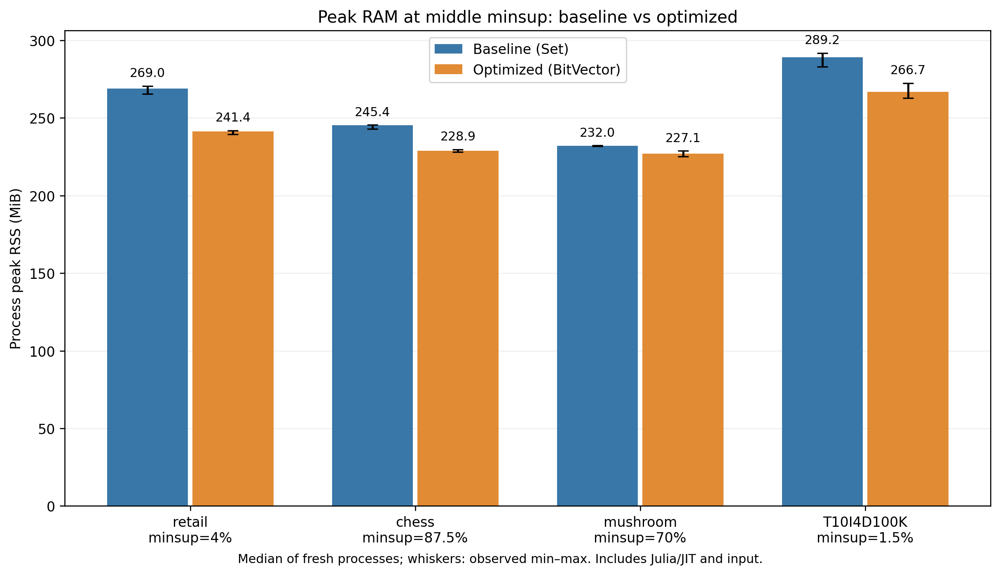

# Peak RAM: Eclat baseline và optimized

Đối chiếu yêu cầu tại [đề bài](https://hcmus-cs-ta.github.io/lab-book/data-mining/projects/itemset/) và `docs/itemset.md`: đo RAM tối đa cho mỗi dataset tại minsup trung bình, so sánh bản cơ bản và tối ưu.

## Phương pháp

- Dùng toàn bộ giao dịch của 4 dataset FIMI đã chọn, cùng file chuẩn hóa và minsup cho Set/BitVector; giữ các giỏ trùng. Retail và T10I4D100K cộng 1 vào ID. Phiên bản Mushroom này có 8.124 giao dịch; không gộp với bộ 8.416 giao dịch trong thí nghiệm TV1.
- Minsup trung bình được định nghĩa là điểm thứ 4 trong dải 7 điểm đã pilot, không phải trung bình cộng hai đầu dải. Retail 4%, Chess 87,5%, Mushroom 70%, T10I4D100K 1,5%.
- Mỗi mẫu tạo một tiến trình Julia mới, chỉ chạy một backend, một luồng. Warm-up backend trên cùng một toy database rồi GC; đọc dữ liệu thật rồi GC trước `mine`. Đảo thứ tự Set/BitVector giữa các lần; báo cáo median của các peak cùng khoảng min–max quan sát.
- Đọc `Sys.maxrss()` ngay sau `mine`, khi input/output còn sống, trước khi sort/ghi output. Đây là high-water mark do hệ điều hành ghi nhận, đơn vị byte; MiB = byte / 1024². Trên Windows tương ứng PeakWorkingSetSize qua GetProcessMemoryInfo. Không dùng `@allocated` hay tổng kích thước object để thay peak RSS.
- Phạm vi gồm khởi động Julia, package/JIT, toy warm-up, đọc input và mining tới lúc lấy số đo. Peak của tiến trình không reset được sau warm-up. Cột `pre_mine_peak_rss_bytes` chỉ dùng chẩn đoán; không trừ nó để gọi phần chênh là peak RAM riêng của thuật toán.
- 40 mẫu đều so sánh toàn bộ itemset và support với tham chiếu SPMF được tạo mới từ đúng file chuẩn hóa trước thí nghiệm. Không dùng lại tham chiếu cũ có thể khác mapping ID. Vì cả hai backend đều bằng tham chiếu này, chúng cũng bằng nhau hoàn toàn. SPMF không được đo RAM trong thí nghiệm này.

## Kết quả

| Dataset | Minsup | Giao dịch | Itemsets | Set median MiB [min–max] | BitVector median MiB [min–max] | Giảm RAM (%) |
| --- | ---: | ---: | ---: | ---: | ---: | ---: |
| retail | 4% | 88162 | 18 | 268.98 [265.48–270.59] | 241.36 [239.61–241.96] | +10.27 |
| chess | 87.5% | 3196 | 1386 | 245.35 [242.87–245.48] | 228.95 [228.06–229.75] | +6.69 |
| mushroom | 70% | 8124 | 31 | 232.04 [231.74–232.29] | 227.05 [225.07–228.78] | +2.15 |
| T10I4D100K | 1.5% | 100000 | 237 | 289.16 [282.95–291.79] | 266.75 [262.76–272.38] | +7.75 |

Giảm RAM = 100 × (1 − median BitVector / median Set). Giá trị âm nghĩa là optimized dùng nhiều RAM hơn.



## Phân tích và giới hạn

- retail: median peak của BitVector thấp hơn Set 10.27% trong cấu hình này. Đây là so sánh peak của cả tiến trình tới hết mining.
- chess: median peak của BitVector thấp hơn Set 6.69% trong cấu hình này. Đây là so sánh peak của cả tiến trình tới hết mining.
- mushroom: median peak của BitVector thấp hơn Set 2.15% trong cấu hình này. Đây là so sánh peak của cả tiến trình tới hết mining.
- T10I4D100K: median peak của BitVector thấp hơn Set 7.75% trong cấu hình này. Đây là so sánh peak của cả tiến trình tới hết mining.
- Diễn giải từ cấu trúc code: mỗi BitVector cần khoảng N bit. Nếu cấp phát trước khi lọc singleton, cả item hiếm cũng chiếm một vector đầy đủ; lọc support trước sẽ tránh chi phí đó. Set lưu các TID có mặt nhưng chịu overhead bảng băm. Chi phí BitVector còn phụ thuộc số item được giữ lại và mật độ TID-set, nên dữ liệu thưa không đồng nghĩa với luôn tốn RAM hơn. Ngoài biểu diễn dọc, peak còn chịu input, output, giao ứng viên, GC, allocator và JIT; chưa tách được đóng góp từng phần.
- Khoảng min–max phản ánh dao động quan sát, không phải khoảng tin cậy. Một backend được đặt tên optimized không đảm bảo giảm RAM trên mọi dataset. Không suy rộng kết luận sang ngưỡng support khác hoặc coi số này là peak riêng của hàm `mine`.
- Thí nghiệm này hoàn thành phép so sánh bộ nhớ tại minsup trung bình; không thay thế scalability hoặc thí nghiệm thay đổi độ dài giao dịch.

## Dữ liệu và chạy lại

- [runs.csv](runs.csv): từng peak OS tính bằng byte, peak trước mining, số itemset và trạng thái kiểm chứng.
- [summary.csv](summary.csv): median/min/max theo MiB, tỉ số và phần trăm giảm.
- [metadata.md](metadata.md): máy, Julia/Java, quy trình, checksum dữ liệu/JAR/tham chiếu/core/runner.
- `spmf/`: tham chiếu SPMF mới ở đúng minsup và mapping ID đã đo.
- `peak_ram.svg`: bản vector để đưa vào báo cáo.

```powershell
julia --startup-file=no --project=. scripts/benchmark_peak_ram.jl
python scripts/plot_peak_ram.py
```

Julia không cần package đo RAM bên ngoài; Java và `data/benchmark/tools/spmf.jar` dùng để tạo tham chiếu correctness ngoài phép đo RAM; Python cần matplotlib để vẽ. Nếu đã có kết quả, chọn thư mục mới bằng `--output-dir`; runner từ chối ghi đè. Script vẽ nhận đường dẫn thư mục kết quả làm đối số tùy chọn.

Nguồn định nghĩa metric: [Julia Sys.maxrss](https://docs.julialang.org/en/v1/base/base/#Base.Sys.maxrss), [Windows PROCESS_MEMORY_COUNTERS](https://learn.microsoft.com/en-us/windows/win32/api/psapi/ns-psapi-process_memory_counters).
