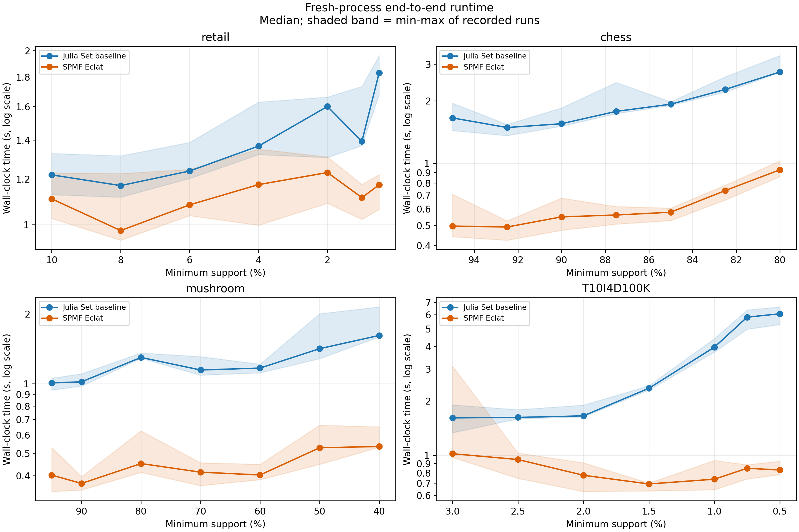
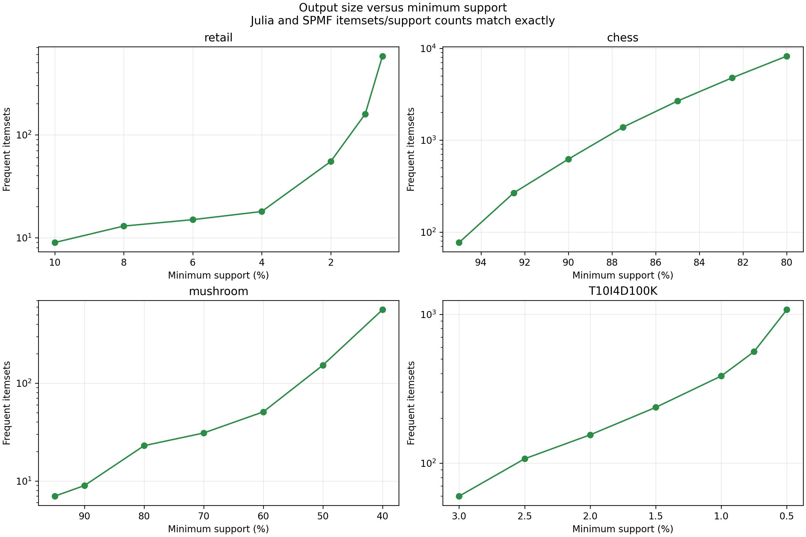

# Báo cáo runtime Julia baseline và SPMF

Đã chạy 28 cấu hình và ghi nhận 280 lần đo. Mọi lần đo đều được đối chiếu toàn bộ itemset và support count giữa hai chương trình.

## Cách đo

Mỗi mẫu tạo tiến trình mới, tính khởi động Julia/Java, nạp package/lớp, JIT, đọc đầu vào, dựng TID-set, khai thác và ghi kết quả/log. Hai bên dùng cùng file đã chuẩn hóa và cùng minsup. Mỗi cấu hình có một lượt chuẩn bị mỗi backend không ghi nhận, sau đó đo lặp; lượt đo vẫn là tiến trình mới và vẫn tính JIT. Thứ tự hai backend đảo giữa các lần. Chuẩn hóa dữ liệu và so sánh kết quả thực hiện ngoài đồng hồ.

Các số này là thời gian toàn bộ tiến trình. Không ghép trực tiếp với các CSV `*_baseline.csv` trước đó vốn đo riêng `mine` trên dữ liệu trong RAM sau warm-up. Các lần chạy dùng cache hệ điều hành có sẵn; không phải thí nghiệm cold disk cache. Các tiến trình nền của Windows không được kiểm soát hoàn toàn.

Cấu hình máy, phiên bản Java/Julia và checksum nằm trong [metadata.md](metadata.md). SPMF được nhận diện bằng SHA-256 của JAR; nhãn ECLAT v2.65 trong log không được dùng để suy ra phiên bản toàn bộ thư viện.

Mã chạy lại nằm trong `scripts/` của dự án. Metadata chỉ lưu checksum mã tại thời điểm đo; checksum có thể khác nếu sửa script sau lần đo.

## Kết quả tại minsup thấp nhất của mỗi bộ

| Dataset | Minsup | Itemset | Julia median (s) | SPMF median (s) | Julia/SPMF |
| --- | ---: | ---: | ---: | ---: | ---: |
| retail | 0.005 | 580 | 1.8311 | 1.1722 | 1.56 |
| chess | 0.8 | 8227 | 2.7545 | 0.9285 | 2.97 |
| mushroom | 0.4 | 565 | 1.6153 | 0.5351 | 3.02 |
| T10I4D100K | 0.005 | 1073 | 6.0708 | 0.8300 | 7.31 |

SPMF có median toàn bộ tiến trình thấp hơn tại 28/28 cấu hình. Tỉ số Julia/SPMF lớn hơn 1 nghĩa là Julia mất nhiều thời gian hơn trong phép đo này.

## Phân tích và giới hạn

- Khi minsup giảm, số itemset tăng hoặc giữ nguyên. Output lớn hơn tạo thêm việc giao TID-set, duyệt nhánh, cấp phát và ghi file. Runtime thực tế còn chịu chi phí khởi động, JIT, GC và dao động hệ thống, nên không bắt buộc tăng tại mọi điểm.
- Dense/sparse là một yếu tố, nhưng không thể dùng riêng số giao dịch hoặc số itemset để giải thích hết runtime. Chi phí giao Set còn phụ thuộc kích thước TID-set và số ứng viên.
- Không suy ra ngôn ngữ hay thuật toán nào luôn nhanh hơn từ phép đo này. Chưa có phép đo kernel Julia và Java cùng warm-up trong tiến trình lâu dài; chưa tách riêng thời gian I/O/JIT. Khoảng min-max trên hình là độ dao động quan sát, không phải khoảng tin cậy.
- Correctness xác nhận trên các dữ liệu và ngưỡng đã chạy; không thay thế kiểm thử tổng quát và không chứng minh backend chưa được cài đặt.

## Bảng đầy đủ

| Dataset | Minsup | Itemset | Julia median (s) | SPMF median (s) | Julia/SPMF | Khớp |
| --- | ---: | ---: | ---: | ---: | ---: | --- |
| retail | 0.1 | 9 | 1.2196 | 1.1087 | 1.10 | true |
| retail | 0.08 | 13 | 1.1687 | 0.9771 | 1.20 | true |
| retail | 0.06 | 15 | 1.2385 | 1.0824 | 1.14 | true |
| retail | 0.04 | 18 | 1.3676 | 1.1732 | 1.17 | true |
| retail | 0.02 | 55 | 1.6015 | 1.2311 | 1.30 | true |
| retail | 0.01 | 159 | 1.3936 | 1.1140 | 1.25 | true |
| retail | 0.005 | 580 | 1.8311 | 1.1722 | 1.56 | true |
| chess | 0.95 | 77 | 1.6526 | 0.4965 | 3.33 | true |
| chess | 0.925 | 267 | 1.4847 | 0.4912 | 3.02 | true |
| chess | 0.9 | 622 | 1.5492 | 0.5500 | 2.82 | true |
| chess | 0.875 | 1386 | 1.7769 | 0.5615 | 3.16 | true |
| chess | 0.85 | 2669 | 1.9246 | 0.5790 | 3.32 | true |
| chess | 0.825 | 4777 | 2.2682 | 0.7368 | 3.08 | true |
| chess | 0.8 | 8227 | 2.7545 | 0.9285 | 2.97 | true |
| mushroom | 0.95 | 7 | 1.0078 | 0.4026 | 2.50 | true |
| mushroom | 0.9 | 9 | 1.0180 | 0.3705 | 2.75 | true |
| mushroom | 0.8 | 23 | 1.2980 | 0.4515 | 2.87 | true |
| mushroom | 0.7 | 31 | 1.1454 | 0.4144 | 2.76 | true |
| mushroom | 0.6 | 51 | 1.1675 | 0.4031 | 2.90 | true |
| mushroom | 0.5 | 153 | 1.4160 | 0.5284 | 2.68 | true |
| mushroom | 0.4 | 565 | 1.6153 | 0.5351 | 3.02 | true |
| T10I4D100K | 0.03 | 60 | 1.6115 | 1.0211 | 1.58 | true |
| T10I4D100K | 0.025 | 107 | 1.6212 | 0.9482 | 1.71 | true |
| T10I4D100K | 0.02 | 155 | 1.6536 | 0.7759 | 2.13 | true |
| T10I4D100K | 0.015 | 237 | 2.3504 | 0.6946 | 3.38 | true |
| T10I4D100K | 0.01 | 385 | 3.9659 | 0.7379 | 5.37 | true |
| T10I4D100K | 0.0075 | 561 | 5.8134 | 0.8481 | 6.85 | true |
| T10I4D100K | 0.005 | 1073 | 6.0708 | 0.8300 | 7.31 | true |

## Biểu đồ và dữ liệu gốc





- [summary.csv](summary.csv): median/min/max và tỉ số từng cấu hình.
- [runs.csv](runs.csv): từng mẫu thời gian và kết quả đối chiếu.
- Có thêm bản SVG để dùng trong báo cáo.

## Phần Lab 2 còn lại

- Backend BitVector của TV1 chưa có, nên chưa so sánh baseline với optimized.
- Chưa đo peak RSS cho baseline/optimized tại minsup trung bình. Không dùng số allocation hoặc thống kê memory nội bộ Java thay thế peak RSS.
- Chưa đo scalability Retail 10%, 25%, 50%, 75%, 100%.
- Chưa chạy thí nghiệm tổng hợp thay đổi độ dài giao dịch.
- Hướng tối ưu đề xuất để đánh giá tiếp: giao tidset bằng BitVector/popcount khi phù hợp; sắp xếp nhánh theo support và giảm các bản sao/cấp phát Set. Chưa có bằng chứng thực nghiệm trong lần đo này rằng các thay đổi đó chắc chắn nhanh hơn.

## Chạy lại

Tại thư mục dự án, chạy tuần tự:

```powershell
julia --startup-file=no --project=. scripts/benchmark_processes.jl
python scripts/plot_process_benchmarks.py
```

Python cần matplotlib cho bước vẽ; khai thác và đo thời gian dùng Julia/Java. Lệnh đo mặc định ghi đè runs.csv, summary.csv và metadata của lần đo trước trong thư mục processes; dùng --output-dir để giữ một lần đo riêng.
