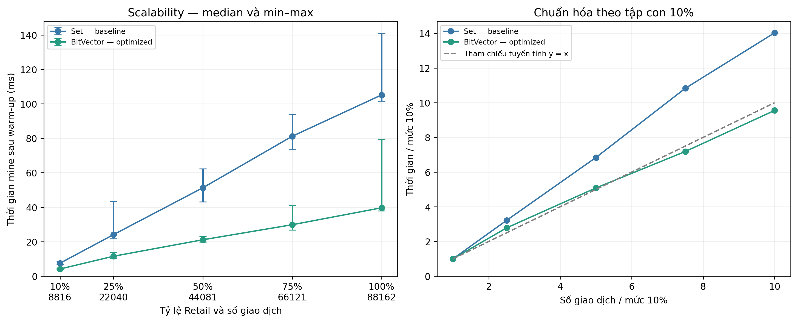

# Scalability: Retail 10%, 25%, 50%, 75%, 100%

Đã đo 50 mẫu Julia trên năm kích thước Retail, cho cả Set và BitVector, giữ minsup tương đối cố định ở 4%. Mọi output được đối chiếu toàn bộ itemset/support với SPMF.

## Phương pháp

- Retail đầy đủ có 88.162 giao dịch; cộng 1 vào ID để đáp ứng hợp đồng ID dương. Từ một hoán vị chỉ số dòng có seed cố định, lấy lần lượt floor(N × tỷ lệ) chỉ số đầu, rồi sắp lại theo thứ tự dòng gốc. Tập nhỏ nằm trong tập lớn. Giao dịch trùng vẫn giữ riêng. Seed, thuật toán chọn và checksum từng tập con/chỉ số nằm trong [metadata.md](metadata.md).
- Mỗi mẫu tạo tiến trình Julia mới, một luồng; đọc tập con và warm-up mine một lần trên đúng tập con/cùng minsup. Sau GC, đo một lần mine bằng @elapsed. Không tính khởi động, đọc input, warm-up/JIT, GC trước đo, ghi output hoặc correctness. GC bên trong mine được tính. Thứ tự hai backend đảo giữa các lần.
- Đây là wall-clock của hàm mine sau warm-up, khác phép đo toàn bộ tiến trình trong processes/. SPMF tạo tham chiếu ngoài phép đo, không được đặt lên cùng đường runtime với kernel Julia.
- Giữ minsup tương đối nên min_count tăng theo số giao dịch. Số itemset có thể thay đổi do phân bố tập con và làm tròn support. Runtime không bắt buộc tăng tại mọi điểm.

## Kết quả

| Retail | Giao dịch | Min count | Itemsets | Set median ms [min–max] | BitVector median ms [min–max] | Set / BitVector |
| --- | ---: | ---: | ---: | ---: | ---: | ---: |
| 10% | 8816 | 353 | 18 | 7.494 [7.015–8.806] | 4.151 [3.840–4.378] | 1.81 |
| 25% | 22040 | 882 | 18 | 24.107 [21.718–43.489] | 11.557 [10.281–13.693] | 2.09 |
| 50% | 44081 | 1764 | 18 | 51.274 [43.099–62.282] | 21.116 [19.758–23.070] | 2.43 |
| 75% | 66121 | 2645 | 18 | 81.147 [73.320–93.875] | 29.829 [26.854–41.274] | 2.72 |
| 100% | 88162 | 3527 | 18 | 105.122 [101.536–140.864] | 39.658 [37.834–79.385] | 2.65 |

Tỉ số Set / BitVector lớn hơn 1 nghĩa là Set mất nhiều thời gian hơn trong cấu hình tương ứng.



## Nhận xét về xu hướng

Số giao dịch ở mức 100% gấp 10.0002 lần mức 10%. Đường y = x ở hình chuẩn hóa là tham chiếu tăng tỷ lệ thuận với N, không phải đường dự đoán bắt buộc của Eclat.

- Set: tỉ số median thời gian 100% / 10% = 14.028; tỉ số tăng thời gian / tăng số giao dịch = 1.403. Khớp mô tả tuyến tính t = aN + b trên năm median: a = 1.2436665e-06 s/giao dịch, b = -0.003186 s, R² = 0.9990. Năm điểm phù hợp khá tốt với xu hướng tăng gần tuyến tính trong miền đo.
- BitVector: tỉ số median thời gian 100% / 10% = 9.554; tỉ số tăng thời gian / tăng số giao dịch = 0.955. Khớp mô tả tuyến tính t = aN + b trên năm median: a = 4.3860471e-07 s/giao dịch, b = 0.001155 s, R² = 0.9977. Năm điểm phù hợp khá tốt với xu hướng tăng gần tuyến tính trong miền đo.
- Tỉ số tăng thời gian / tăng số giao dịch lớn hơn 1 nghĩa là thời gian tăng nhanh hơn tỷ lệ N khi xét hai mốc 10% và 100%. Khớp tốt với t = aN + b có hệ số chặn khác 0 không đồng nghĩa với tỷ lệ thuận t = aN; cần đọc cả đường chuẩn hóa và các số đo gốc.
- Eclat còn phụ thuộc số item, support TID-set, số ứng viên và số frequent itemset. Vì vậy năm điểm trên chỉ mô tả miền đo ở minsup này; R² hoặc tỉ số thời gian không chứng minh độ phức tạp tuyến tính tổng quát. Độ lệch khỏi đường tỷ lệ thuận có thể đến từ cấu trúc tập con, cấp phát/GC, cache và dao động hệ thống; chưa tách riêng từng nguyên nhân.
- Với Set, TID-set lớn hơn làm tăng chi phí dựng bảng băm và giao tập. Với BitVector, vector dài theo số giao dịch; bản hiện tại lọc singleton trước khi cấp vector. Các chi phí này tăng cùng N nhưng số nhánh/output cũng có thể thay đổi.
- Đường thời gian dùng median; min–max chỉ là độ dao động quan sát, không phải khoảng tin cậy. Một hoán vị cố định giúp tái lập và lồng các tập con, nhưng chưa đánh giá độ nhạy trên nhiều seed.

## Tệp kết quả và chạy lại

- [runs.csv](runs.csv): từng thời gian mine và correctness.
- [summary.csv](summary.csv): median/min/max và throughput theo cấu hình.
- [metadata.md](metadata.md): phương pháp tiếng Việt, máy, phiên bản, seed và checksum.
- `spmf/`: năm tham chiếu được tạo từ đúng các tập con.
- `scalability.svg`: bản vector để đưa vào báo cáo.

```powershell
julia --startup-file=no --project=. scripts/benchmark_scalability.jl
python scripts/plot_scalability.py
```

Runner từ chối ghi đè kết quả. Khi chạy lại, dùng --output-dir mới và truyền cùng thư mục cho script vẽ. Có thể chọn --runs, --minsup, --seed và --timeout-seconds; metadata ghi lại đúng các thiết lập. Python cần matplotlib; Julia dùng thư viện chuẩn và package cục bộ.
