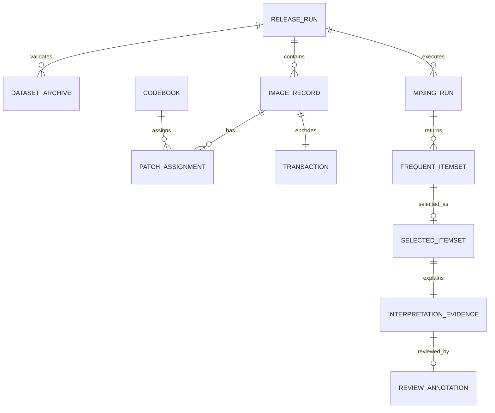

# Data Model: Fashion-MNIST Notebook Release

All persisted records belong to a `run_id`. Each manifest carries `schema_version`, `run_id`, status, relative artifact paths, and SHA-256 values for its inputs and outputs. Release schemas are separate from legacy TC/FIM artifacts.

## Entities

| Entity | Fields | Validation and relationships |
|---|---|---|
| ReleaseRun | `run_id`, `created_at_utc`, `schema_version`, `status`, `run_root` | One run is created by Notebook 01 and is referenced by all later notebooks. `run_root` is `results/fashion/release/<run_id>/`. |
| DatasetArchive | `split`, `kind`, `filename`, `sha256`, `verified` | Four records: train images/labels and test images/labels. Each hash must match the pinned Fashion-MNIST value before IDX parsing. |
| ImageRecord | `image_id`, `split`, `source_index`, `label`, `height`, `width` | `image_id` is `train:<source_index>` or `test:<source_index>`; `source_index` is zero-based within its original split; label is 0–9; dimensions are 28×28. Exactly 60,000 train and 10,000 test records. |
| PatchAssignment | `image_id`, `patch_id`, `patch_row`, `patch_col`, `word_id` | One row per retained patch. Grid coordinates are 1–7, `patch_id` is 1–49, and `word_id` is 1–32. `image_id` references one ImageRecord. |
| Codebook | `codebook_id`, `method`, `k`, `seed`, `centroids`, `archive_hashes`, `sha256` | Release has one B0 codebook with K=32 and seed=123. Each centroid has 16 finite Float32 values in normalized [0,1] descriptor space. |
| Transaction | `tid`, `image_id`, `items` | Exactly one row per image. `tid` is a unique integer 1–70,000; `image_id` references one ImageRecord; `items` is a sorted, unique list of IDs 1–32. Empty `items` is valid and still contributes one record to the denominator. |
| MiningRun | `backend`, `minsup_percent`, `min_count`, `input_sha256`, `source_sha256`, `status`, `itemset_count`, `runtime_seconds`, `peak_rss_mib`, `resource_limits` | One record for each of two backends × six thresholds. For 70,000 transactions, min counts are 56,000, 42,000, 28,000, 14,000, 7,000, and 3,500. |
| FrequentItemset | `items`, `length`, `support_count`, `support_fraction` | `items` is a sorted unique tuple from 1–32; `support_count >= min_count`; `support_fraction = support_count / 70,000`. Rows use canonical order `(length, items)`. |
| SelectedItemset | `selection_order`, `backend`, `minsup_percent`, `items`, `support_count`, `pattern_id`, `length_bucket`, `support_bucket`, `diversity_max_jaccard` | Notebook 03 deterministically selects 3–4 rows from verified Set outputs: seed from `(1/high)`, `(2/mid)`, and `(>=3/low)` length/support cells, then fill by the versioned nine-cell grid. Support tertiles group ties; Jaccard limits are 0.80 with one retry at 0.90. Each row matches its Set itemset/support and records selection provenance. The selected CSV and rule manifest are stored and hashed. |
| InterpretationEvidence | `pattern_id`, `supporting_image_ids`, `patch_witnesses`, `class_counts`, `gallery_paths`, `retrieved_support_count` | Every image and witness references existing transaction/patch records. Retrieved support must equal the mining support. Class counts must sum to retrieved support when labels are present. |
| ReviewAnnotation | `pattern_id`, `review_status`, `visual_coherence`, `interpretation`, `limitations`, `reviewer`, `reviewed_at`, `evidence_paths` | Initial state is `PENDING_REVIEW`; a completed human review records reviewer and review time. |

## Relationships

## State and Integrity Rules

- Run-level flow: `DATASET_VALIDATED → TRANSACTIONS_VALIDATED → MINING_COMPLETE_OR_PARTIAL → INTERPRETATION_PENDING_REVIEW → REVIEWED`. A failed step records `FAILED` or `BLOCKED` and does not create a success status for its downstream artifact.
- A mining run may be `COMPLETED_FULL`, `COMPLETED_ZERO`, or an explicit bounded/failure status (`TIMEOUT`, `MEMORY_LIMIT`, `OUTPUT_LIMIT`, `INVALID_OUTPUT`, `FAILED`, or `UNKNOWN_INTERRUPTED`). Only a completed pair can have parity `PASS`.
- One transaction per image is invariant even if patch filtering leaves no visual words. Empty transactions count in the denominator used to interpret the six minimum counts.
- The complete Set and BitVector outputs are compared as maps from sorted item tuple to support count. Counts alone are not sufficient evidence of parity.
- The stored transaction-file hash, the canonical image IDs, archive hashes, and configuration hash are inputs to downstream artifact identity. A changed input creates a new run directory rather than reusing prior outputs.
